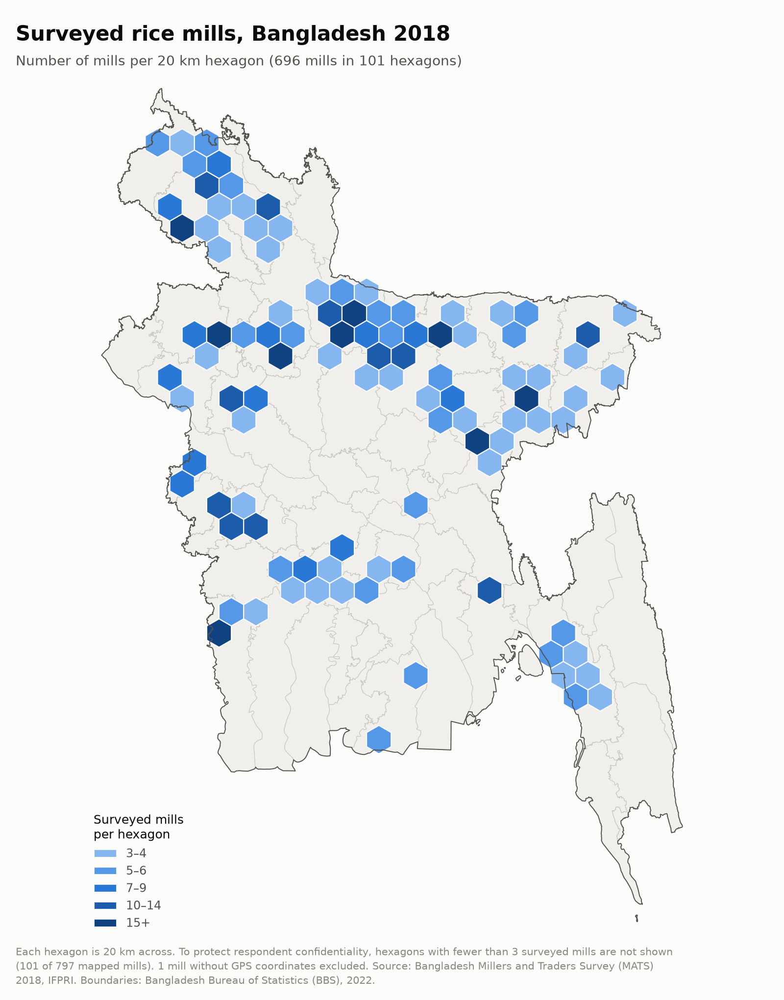

# Bangladesh Rice Mills Map

Where were the 798 rice mills in the 2018 Bangladesh Millers and Traders Survey (MATS)? This
repository maps them without revealing where any individual mill is.

**[Open the interactive map →](https://razin-kabir.github.io/bangladesh-rice-mills-map/)**



## How mills are shown

Exact mill locations are confidential, so mills are counted in **hexagons 20 km across**:

- hexagons with fewer than **3** surveyed mills are not shown (101 of 797 mapped mills);
- median milling capacity is shown only for hexagons with at least **5** mills, rounded to two
  significant figures;
- names, addresses, interviewer fields and mill IDs are never read, and no point locations are
  written anywhere.

The interactive map can show all mills, each mill type (husking, semi-automatic, automatic) or
each ownership type over an OpenStreetMap basemap (or a plain district view). It can be filtered
by division and has a table view. A by-type version of
the printable map is in [`figures/`](figures/rice_mills_hexmap_by_type.png).

**Notes on the variables.**
- Milling capacity is the survey's *fortnightly* capacity in metric tons.
- Ownership is the type of ownership in the first year of each mill's reported history, not
  necessarily 2018.
- One mill has no GPS coordinates and is excluded.

## Repository layout

```
analysis/
  mats_miller_map.ipynb    pipeline: load -> aggregate to hexagons -> web map + printable maps
  millmap.py               hexagon grid, aggregation, map drawing
  webmap_template.html     interactive map page (Leaflet); data are inserted at build time
  common.py                paths and confidentiality settings (HEX_KM, MIN_MILLS, ...)
docs/index.html            the interactive map (served by GitHub Pages)
figures/                   printable maps (PNG)
data/                      how to obtain the input data (not included) + checksums
scripts/check_repo.py      pre-publication privacy check
```

## Reproducing the maps

**Requirements:** [uv](https://docs.astral.sh/uv/) (installs Python ≥ 3.11 and the pinned
packages in `uv.lock`) and `make`. Access to the MATS 2018 data is described in
[`data/README.md`](data/README.md).

```bash
git clone https://github.com/razin-kabir/bangladesh-rice-mills-map.git
cd bangladesh-rice-mills-map
uv sync --frozen

export MATS_DATA_DIR=/path/to/mats_2018           # folder containing miller_data/
export BD_DISTRICT_SHP=/path/to/district2022.shp

make verify-data    # optional: confirm you have the same input files
make                # rebuilds docs/index.html and figures/*.png (about 15 seconds)
make preview        # view the interactive map at http://localhost:8000
                    # (OpenStreetMap tiles need http(s); they don't load from file://)
```

Without `make` (e.g. Windows): `cd analysis` then
`uv run python -m nbconvert --to notebook --execute mats_miller_map.ipynb --output-dir ../build`.

The confidentiality settings live in `analysis/common.py`. If you change them, re-run
`make check`.

## Privacy

- No microdata, shapefiles or point locations are committed; `.gitignore` blocks data formats.
- The notebook is committed **without outputs**.
- `make check` runs before every commit (local hook) and on every push (GitHub Actions). It
  scans all published files for data files, notebook outputs, local paths, e-mail addresses,
  phone numbers, high-precision coordinates and references to identifying survey variables.
- It also audits the data inside `docs/index.html`. Every published shape must be a hexagon
  with at least 3 mills, capacity may only appear where there are at least 5, and the file may
  contain no points and no coordinate finer than 4 decimal places.

## Sources and citation

- Survey: Bangladesh Millers and Traders Survey (MATS) 2018, IFPRI. See Dorosh, Minot, Kabir
  and Hossain (2021), *Private sector rice stocks in Bangladesh: Estimates from the Bangladesh
  Millers' and Traders' Survey (MATS) 2018*, <https://hdl.handle.net/10568/143610>.
- Boundaries: Bangladesh Bureau of Statistics (BBS), 2022.
- Basemap: © [OpenStreetMap](https://www.openstreetmap.org/copyright) contributors. Map library: [Leaflet](https://leafletjs.com).

To cite this repository, see [`CITATION.cff`](CITATION.cff).

## License

[MIT](LICENSE).
